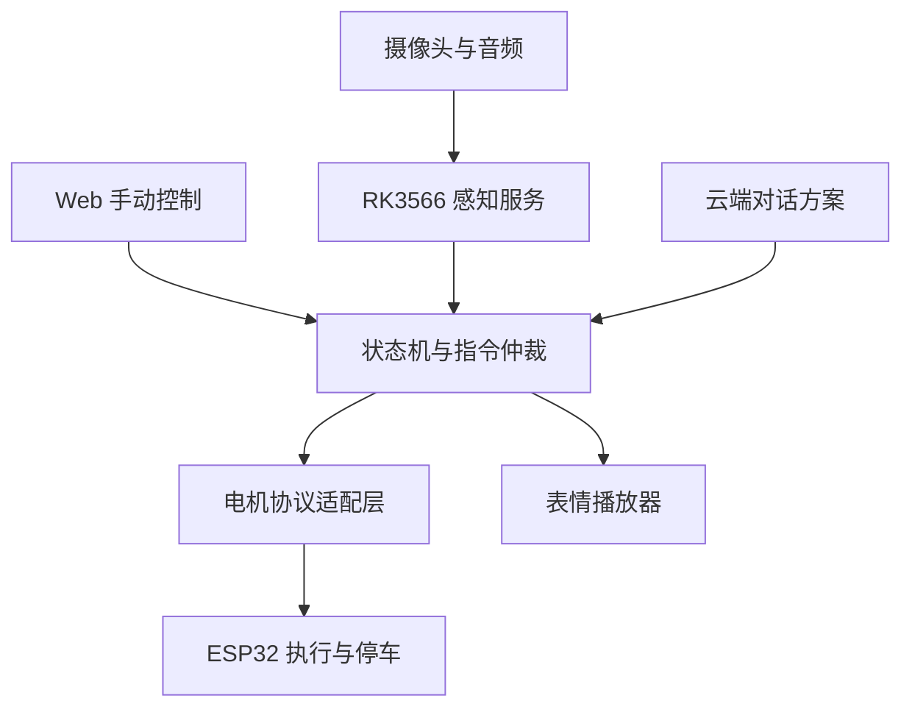

# 架构与协议边界

这是目标分层架构，不表示图中所有服务已经完成实机集成。

## 各工程的职责

- `m10-robot-core`：Linux 真实硬件发现、生命周期、状态机、Web 服务和早期串口桥接。
- `m10-vision`：可单测的视觉 / 跟踪 / 决策核心、Mac 仿真及 NPU 探测。电机默认 Mock。
- `m10-hardware-test`：ESP32 正式 M10 V2 候选固件与旧文本协议测试草图。
- `m10-face-ui` / `m10-face-android`：独立的 Web / Android 表情端。

## 协议还没有完全统一

| 路线 | 格式 | 使用边界 |
| --- | --- | --- |
| 正式 ESP32 候选 | M10 Protocol V2 二进制、CRC16、序号、ACK、到期停车 | 以固件目录和实机调试记录为准 |
| 早期接线草图 | 一行一条文本命令 | 仅用于接线实验 |
| 视觉 C++ MotorDriver | 现有文本封装 | 与正式 V2 不直接兼容，需适配 |
| Android HTTP | 状态与单次检测 / 跟随决策接口 | 不能当作连续视觉到底盘闭环 |

旧设计笔记中的蓝牙替代路线没有完成，正式可复现路线优先围绕现有 USB / 串口验证收敛。

## 数据与动作

视频预览和动作闭环分开。跟踪应使用本机最新帧及时间戳，HLS 只作为远程预览候选。手动与 AI 动作统一仲裁，丢帧、过期观测、未确认身份和通信异常不能继续授权前进。
