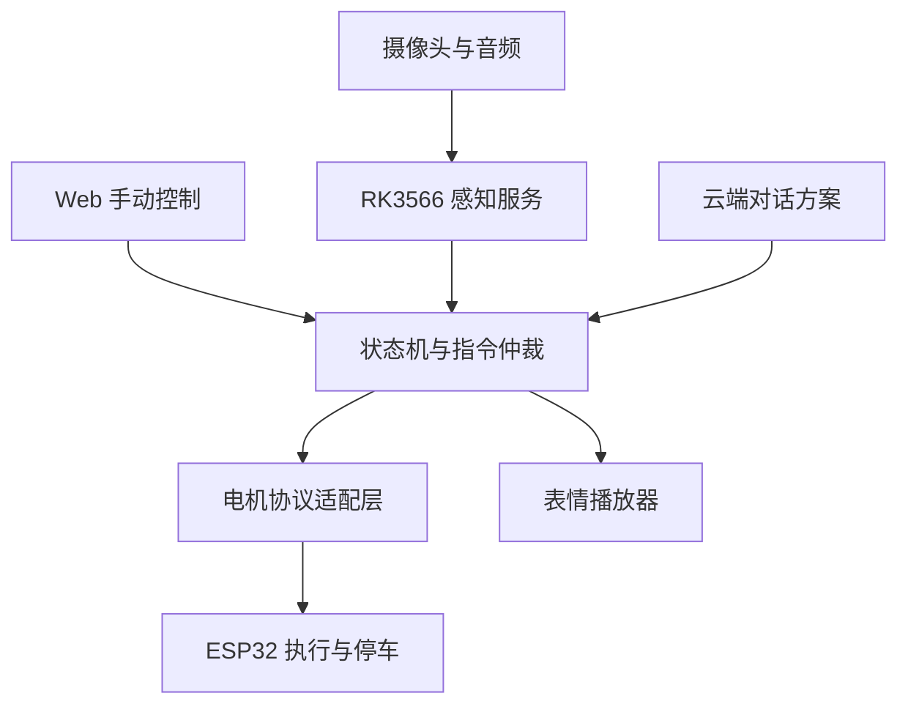

# 架构与协议边界

新增统一启动入口见 [one-click.md](one-click.md)：`m10_runtime/` 已整合人工遥控、表情、可选图传和 ESP32 V2；下述感知 / 自动行为分层仍是目标架构，尚未完成连续跟随集成。

这是目标分层架构，不表示图中所有服务已经完成实机集成。

## 各工程的职责

- `m10-robot-core`：Linux 真实硬件发现、生命周期、状态机、Web 服务和早期串口桥接。
- `m10-vision`：可单测的视觉 / 跟踪 / 决策核心、Mac 仿真及 NPU 探测。电机默认 Mock。
- `m10-hardware-test`：ESP32 正式 M10 V2 候选固件与旧文本协议测试草图。
- `m10-face-ui` / `m10-face-android`：独立的 Web / Android 表情端。

## 协议还没有完全统一

| 路线 | 格式 | 使用边界 |
| --- | --- | --- |
| 正式 ESP32 候选 | M10 Protocol V2 二进制、CRC16、序号、ACK、到期停车 | 以固件目录和实机调试记录为准 |
| 早期接线草图 | 一行一条文本命令 | 仅用于接线实验 |
| 视觉 C++ MotorDriver | 现有文本封装 | 与正式 V2 不直接兼容，需适配 |
| Android HTTP | 状态与单次检测 / 跟随决策接口 | 不能当作连续视觉到底盘闭环 |

旧设计笔记中的蓝牙替代路线没有完成，正式可复现路线优先围绕现有 USB / 串口验证收敛。

## 数据与动作

视频预览和动作闭环分开。跟踪应使用本机最新帧及时间戳，HLS 只作为远程预览候选。手动与 AI 动作统一仲裁，丢帧、过期观测、未确认身份和通信异常不能继续授权前进。

## 运行时边界

Android 路线已有 Camera2、TFLite 和本地表情 HTTP；Linux 路线以 Python 服务和外设探测为主；C++ 核心用于算法与协议演示。它们不是三个已通过统一 IPC 连接的进程。先选择主运行系统，再定义摄像头、推理、音频、串口和显示的唯一拥有者，避免重复打开设备。

建议使用以下边界组织集成，而不是让每个模块直接写电机：

| 层 | 输出 | 要限制的内容 |
| --- | --- | --- |
| 感知 | 带时间戳的检测、目标和置信度 | 不直接产生持久运动 |
| 行为 | 期望速度或短时动作建议 | 不绕过手动 / 急停仲裁 |
| 仲裁 | 唯一被授权的动作 | 明确模式、来源、有效期和停止原因 |
| 适配 | V2 字节帧与链路状态 | 统一量纲、序号、握手和 ACK |
| MCU | PWM 与停车 | 独立执行通信看门狗和动作期限 |

这是待集成设计；当前 `CommandDispatcher` 尚不是覆盖手动、视觉和语音的完整仲裁器。

## 三种时钟和两种有效期

本机单调时钟用于观测新鲜度、推理超时和动作有效期；日志墙钟用于人工追溯；跨设备时间需另外同步或通过序号 / 本地接收时刻约束。不要把不同机器的时间戳直接相减当成精确延迟。

“上一次有效通信到现在多久”与“当前视觉结果距采集多久”分别检查。即使心跳持续，目标帧过期仍应撤销自动移动。队列保留最新数据；网络恢复后不重放积压的旧运动请求。

## 配置、状态与实现必须对应

当前 YAML 中的 `auth_enabled`、心跳、超时和隐私参数不代表所有路径已消费这些配置。C++ `main.cpp` 没有读取该 YAML；Linux 的 unknown 传感器处理与目标保守策略也有差异。实际行为应依据入口、调用链和测试，而不是只看配置文件。

推荐仲裁优先级为急停 / 故障 → 到期停车 → 人工接管 → 已授权自动任务 → 空闲。优先级、故障恢复与重新授权仍需落实到统一实现。具体缺口与验收见 [problem-log.md](problem-log.md)。
